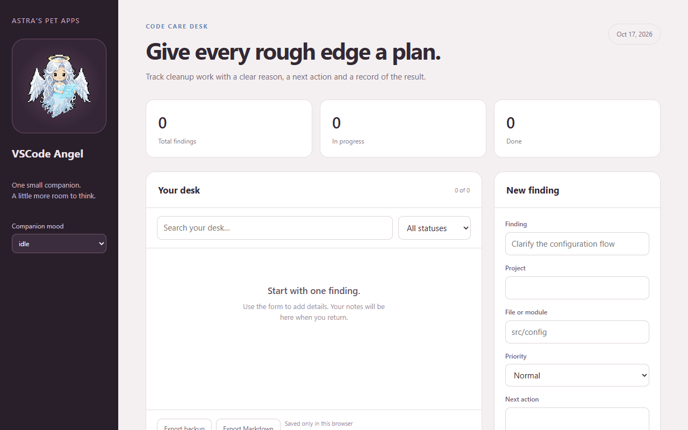

# Vscode Angel

*A pet app by Astra.*

## VSCode Angel

Track cleanup work with a clear reason, a next action and a record of the result.

## Pictures

VSCode Angel's [program page](https://findastra.github.io/astras-pet-os/apps/vscode-angel-20261008.html) as published in Astra's PetOS.

Screenshots taken 2026-10-17 with GitHub Goldfish's [project-image-generator](https://github.com/findastra/github-goldfish#project-image-generator); added with Claude Opus 5.5 (`claude-opus-5-5`), 2026-10-17.

## How to run

Open [vscode-angel-20261008.html](vscode-angel-20261008.html) directly in a modern browser. No install, server, account, or network connection is needed.

## What works

- Add and edit finding records with purpose-specific fields.
- Search, filter by status, advance a record, and delete with undo.
- Keep entries in this browser's local storage.
- Export a private JSON backup or Markdown worklist.
- Choose among all nine pet moods.

Editor connections are planned. Add findings here and export a Markdown worklist.

## Data and limits

Records are stored only in the browser where you enter them. Clearing site data can remove them; export backups. Exported records can contain personal information and must stay outside this source repository. The page does not send entries to a server. The pet's mood is a display choice.

## Source version

Version `0.1.1-20261009`, planned tag [`v0.1.1-20261009`](https://github.com/findastra/vscode-angel/tree/v0.1.1-20261009). Source publication and release verification are recorded separately from local feature checks in `docs/publications-20261009.md` (previous release: `docs/publications-20261008.md`).

## Credits

Made by Astra. Interface prepared with Codex (GPT-6), 2026-10-08. The pet artwork is copied from Astra's PetOS.

Desktop pet revision by OpenAI Codex (GPT-6), 2026-10-11. See desktop-pet-20261011.json for the current artwork, size and behavior. Desktop art remains a draft; no sparkles.
